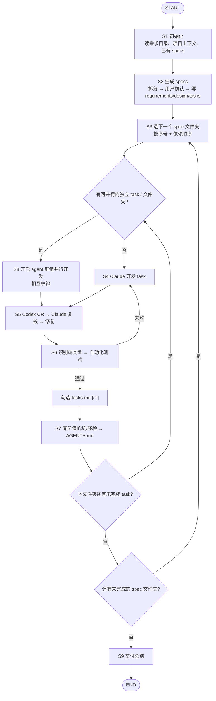

# EWB 交付工作流

输入：`$ARGUMENTS`
- 第一个参数：需求文档目录（默认 `./docs`）。目录下所有 `.md` 都视为需求输入；也可以直接传单个 PRD 文件。
- 第二个参数：specs 输出目录（默认 `./specs`）。

## 总览



---

## S1 初始化

1. 完整读取需求目录下的所有文档（不要只读一部分）。
2. 读取项目上下文：根目录 `AGENTS.md`（含「开发经验沉淀」一节）、`apps/web/AGENTS.md`、`package.json`、相关 `.env.schema`。
3. 确认是 git 仓库（CR 和回滚都依赖 diff）。不是的话先询问用户是否 `git init` 并提交基线。
4. 检查 Codex CR 能力：
   - 首选 `/codex-review` 斜杠命令：看本会话可用的 skill / 命令列表里有没有 `codex-review`（插件命令可能显示为 `<插件名>:codex-review`）。
   - 没有时检查 Codex CLI：`command -v codex` 且 `codex login status` 已登录，S5 改用 CLI 兜底。
   - 两者都没有：告诉用户安装插件或 CLI（`npm i -g @openai/codex` 并登录）。用户明确同意跳过时才改用 `/code-review`，并在总结里注明。
5. 如果 specs 目录已存在且有内容：**断点续跑**——跳过 S2，直接从第一个仍有 `[ ]` 的文件夹开始 S3。

## S2 生成 specs

### 2.1 拆分需求
- 识别**相互独立、可单独开发交付**的需求单元（功能模块/用户故事/特性）。
- 粒度：一个需求 = 一个可以独立设计、开发、验收的功能。太大（跨多个模块）就继续拆，太小（只是一个字段）就合并。
- 全局性内容（背景、术语、通用非功能需求）不单独成文件夹，写入 `00-overview/README.md`。

### 2.2 先输出拆分清单让用户确认
用表格列出：序号、文件夹名、需求名称、一句话描述、依赖的其他需求、**涉及端（web / app / 后端）**、**可否与其他文件夹并行**。
等用户确认或调整后再生成文件（用户明确说“直接生成/直接开发”时可跳过确认）。

### 2.3 目录结构
文件夹命名：`<两位序号>-<英文短横线名称>`，序号按建议开发顺序（被依赖的在前）。

```
specs/
├── 00-overview/
│   └── README.md          # 背景、术语、全局约束、需求索引与依赖关系
├── 01-user-login/
│   ├── requirements.md
│   ├── design.md
│   └── tasks.md
├── 02-xxx/
│   └── ...
```

如果输出目录已存在同名文件夹，先告诉用户，不要直接覆盖。

### 2.4 各文件内容模板

#### requirements.md
```markdown
# <需求名称> - 需求说明

> 来源：<需求文件名> § <对应章节>

## 背景与目标
<为什么做，解决什么问题>

## 用户故事
- 作为 <角色>，我希望 <功能>，以便 <价值>

## 功能需求
### FR-1 <名称>
<描述>

**验收标准**
- WHEN <条件> THEN 系统 SHALL <行为>
- ...

## 非功能需求
<性能、安全、兼容性等；没有则写“无特殊要求”>

## 范围外
<明确不做的内容>

## 依赖
<依赖的其他需求文件夹 / 外部系统>

## 待确认问题
<需求中模糊或缺失的点；没有则省略本节>
```

#### design.md
```markdown
# <需求名称> - 技术设计

## 概述
<整体方案一段话>

## 涉及端
<web / app / 后端，决定 S6 跑哪类测试>

## 架构 / 流程
<模块关系或流程，可用 mermaid>

## 数据模型
<Prisma 模型 / 字段>

## 接口设计
<tRPC procedure：路由名、输入 Zod schema、输出、错误码、是否 protectedProcedure>

## 前端 / 交互（如适用）
<页面、组件、状态>

## 异常处理
<边界情况与错误处理>

## 测试策略
<单测、集成、E2E 要覆盖的点，对应验收标准>
```
设计要具体到可以直接开发，并遵循 `AGENTS.md` 的架构约定（依赖方向、工厂函数注入、子路径导入、`ENV` 读取等）。需求未提供的技术细节可以做合理假设，但要标注“（假设）”。

#### tasks.md
```markdown
# <需求名称> - 任务清单

> 状态说明：`[ ]` 未完成，`[✅]` 已完成（已通过 CR 与自动化测试）
> 并行标记：`(P)` 表示与同组其他 `(P)` 任务无依赖，可并行

- [ ] 1. <任务标题>
  - <具体做什么>
  - 涉及文件：<路径（如已知）>
  - 对应需求：FR-1
- [ ] 2. <任务标题> (P)
  - [ ] 2.1 <子任务>
  - [ ] 2.2 <子任务>
- [ ] 3. <任务标题> (P)
- [ ] 4. 编写测试并通过
```
任务规则：
- 每一项都必须以 `- [ ]` 开头（子任务缩进两个空格，同样用 `- [ ]`）。
- 每个任务是一次可完成、可验证的编码动作（约 0.5–4 小时工作量）。
- 按执行顺序排列：先数据层/后端，再接口，再前端，最后测试与联调。
- 每个任务标注“对应需求”，保证每个 FR 至少被一个任务覆盖。
- 无相互依赖的任务标 `(P)`，供 S8 并行使用。
- 只写开发任务，不写“开会”“评审”这类非编码事项。

### 2.5 生成 overview
`00-overview/README.md`：需求摘要 + 需求索引表（链接到各文件夹）+ 依赖关系（mermaid）+ 汇总的待确认问题。
存在**阻塞开发**的待确认问题时，先问用户再进入 S3；不阻塞的按“（假设）”继续。

---

## S3 进入 spec 文件夹

- 按序号顺序选择第一个仍有 `[ ]` 的文件夹；其依赖的文件夹必须已全部 `[✅]`。
- 依次读 `requirements.md` → `design.md` → `tasks.md`，再读 `AGENTS.md` 的「开发经验沉淀」，避免重复踩坑。
- 判断是否有可并行的工作：本文件夹内的 `(P)` 任务，或与其他无依赖关系的文件夹。有则走 S8，否则逐个 task 走 S4。

## S4 Claude 开发

- 一次只做一个 task（含其子任务），改动范围控制在该 task 内。
- 遵循 `AGENTS.md` 的约定；改了 Prisma schema 要 `pnpm db:generate`，改了 `.env.schema` 要 `pnpm run env:generate`。
- 写 web 代码前先读 `apps/web/AGENTS.md`；涉及 Expo / Better Auth / Prisma / Hono / shadcn 时加载对应 skill。
- 完成后先自检：`pnpm check-types`、`pnpm check`（必要时 `pnpm fix`），通过再进入 S5。

## S5 Codex CR → Claude 复核 → 修复

1. **Codex 审查**：
   - **首选 `/codex-review`**：用 Skill 工具调用 `codex-review`（以会话列表里的实际名称为准），args 传审查说明：
     ```
     审查当前未提交的改动（task <编号>，spec 文件夹 specs/<文件夹>）。
     对照 specs/<文件夹>/requirements.md、design.md 以及根目录 AGENTS.md 的架构约定。
     只报告真实问题：正确性 bug、安全问题、需求未满足、违反项目约定。
     每条给出：严重级别(P0/P1/P2)、文件:行号、问题、触发场景、修复建议。没有问题就输出 NO_ISSUES。
     ```
     按该命令自身的流程执行，拿到 Codex 的审查意见后进入第 2 步。如果该命令内部已经包含“Claude 与 Codex 来回讨论直到通过”的循环，就以它的结论为准，第 4 步的轮次限制仍然适用。
   - **兜底：Codex CLI**（`/codex-review` 不可用时）：
     ```bash
     codex review --uncommitted "<同上审查说明>" > /tmp/ewb-cr-<文件夹>-<task编号>.md 2>&1
     ```
     `--uncommitted` 会覆盖已暂存、未暂存和未跟踪的改动，不改动暂存区。
   - 无论哪种方式，Codex 都会把代码发给 OpenAI：发送前确认改动里没有密钥、`.env` 等敏感内容。
2. **Claude 复核**：逐条评估 Codex 的意见，读相关代码验证，给每条下结论：
   - `接受`：问题成立且可修复 → 修复。
   - `驳回`：误报 / 与需求或约定冲突 → 写明理由。
   - `待定`：涉及需求取舍 → 问用户。
3. 向用户输出一张复核表（条目、级别、结论、理由）。
4. 修复所有“接受”项后重跑 `pnpm check-types` / `pnpm check`。若修复改动较大（新增逻辑而非小修），再跑一轮 Codex CR，**最多 3 轮**，仍有 P0/P1 未解决则停下来问用户。

## S6 自动化测试

按本 task 实际改动的路径判断端类型（可多选），每类都要有覆盖本 task 验收标准的测试：

| 端 | 判断依据 | 测试方式 |
| --- | --- | --- |
| 后端 | `apps/server`、`packages/api`、`packages/auth`、`packages/db` | Vitest：用 `appRouter.createCaller(ctx)` 测 procedure，用 Hono `app.request()` 测 HTTP 路由；涉及 DB 的连接测试库 |
| 网页 | `apps/web`、`packages/ui` | Playwright E2E 走关键用户路径；启动 `pnpm dev:web` + `pnpm dev:server` 后可用 `next-dev-loop` skill / next-devtools 验证运行时 |
| App | `apps/native` | jest-expo + React Native Testing Library 测组件/逻辑；关键流程有条件时用 Maestro E2E |

- 项目里还没有对应测试工具时，在本端首次需要时搭好（加依赖、配置、`test` 脚本、`turbo.json` 的 `test` 任务），并把配置方式记入 AGENTS.md。
- 测试失败 → 回到 S4 修复（修复后的改动同样走 S5）。同一问题连续 3 次修不好就停下来问用户。
- **全部通过后**，把 `tasks.md` 中该 task（及其已完成子任务）的 `[ ]` 改为 `[✅]`。未通过的绝不勾选。

## S7 沉淀经验到 AGENTS.md

开发中遇到以下情况，追加到根目录 `AGENTS.md` 末尾的 `## 开发经验沉淀` 一节（没有就创建）：
- 踩过的坑及解决方式（版本差异、框架行为、配置陷阱、报错与根因）。
- 新确立的项目约定（测试配置、目录约定、通用模式）。
- Codex CR 反复指出的同类问题。

格式：`- [YYYY-MM-DD][spec 文件夹] 问题 → 原因 → 做法`，一条一行、可直接执行。
不写：只与本次任务相关的流水账、代码里已经能看出的东西、与已有条目重复的内容（重复时更新原条目）。

## S8 并行开发（agent 群组）

当存在可并行的 `(P)` 任务或互不依赖的 spec 文件夹时：

1. 分组：同组任务之间不能改同一文件，不能共享未完成的 schema / 接口。共享的 Prisma schema、tRPC 路由汇总（`routers/index.ts`）等由主 Claude 先完成，再并行。
2. 用 Agent 工具为每组派一个 subagent，`isolation: "worktree"`，在同一条消息里并行发出。每个 subagent 的提示里写清：spec 文件夹路径、负责的 task 编号、禁止触碰的文件、必须执行 S4 自检和 S6 测试、返回改动摘要与测试结果。
3. **相互校验**：所有 subagent 完成后，再派 reviewer subagent 交叉审查——A 组的改动由 B 组的 agent 审、B 由 A 审，重点看接口契约是否对齐、是否破坏对方的假设。
4. 主 Claude 合并各 worktree 的改动，解决冲突，然后对合并结果统一走 S5（Codex CR）和 S6（全量测试），通过后再勾选各 task。
5. 并行不确定是否安全时，按顺序执行。

## S9 循环与交付

- 一个文件夹的所有 task 都 `[✅]` 后，向用户简报（完成项、CR 结论、测试结果、新增经验），然后回到 S3 处理下一个文件夹。
- 文件夹之间上下文过长时，可提示用户 `/clear` 后重新运行 `/ewb:workflow`，会从断点续跑。
- 全部完成后输出交付总结：
  - 各 spec 文件夹完成情况与任务数
  - Codex CR 轮次、接受/驳回条数
  - 测试覆盖（各端测试数量、通过情况）
  - 写入 AGENTS.md 的经验条目
  - 仍待确认的问题与做过的“（假设）”
- 不自动提交或推送代码；需要提交时询问用户。
