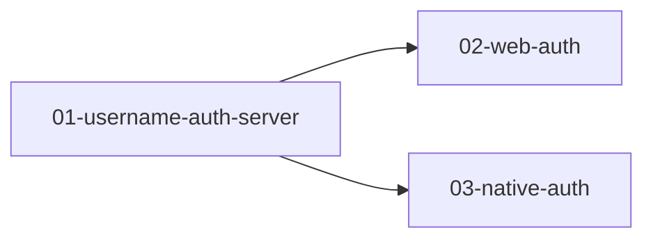

# 登录与注册 - 总览

> 来源：`docs/需求.md`

## 需求摘要

为 ai-admin 后台提供最基础的账号体系：用户名 + 密码注册、登录、退出，未登录用户无法访问后台页面。web 与移动端（Expo）复用同一套 Better Auth 接口。

**范围外（后续迭代）**：邮箱 / 手机号 / 第三方登录、找回与重置密码、角色权限、验证码与登录失败锁定。

## 术语

| 术语 | 含义 |
| --- | --- |
| 用户名（username） | 登录凭据。3–20 位，仅字母、数字、下划线；唯一性不区分大小写（Better Auth 存小写） |
| 显示用户名（displayUsername） | 注册时用户输入的原始大小写，用于界面展示 |
| 占位邮箱 | Better Auth `User.email` 必填且唯一，注册时按 `{小写用户名}@users.ai-admin.local` 生成，不展示、不用于登录 |

## 全局约束

- 密码由 Better Auth 加密存储，任何接口都不返回密码。
- 会话 cookie：`httpOnly`、`secure`、`sameSite: none`；跨域请求需在 `CORS_ORIGIN` 白名单内。
- 移动端会话保存在 SecureStore。
- 关闭邮箱登录入口：只保留 `signIn.username` 和 `signUp.email`（附带 `username`）。
- 所有界面文案为中文；提交中禁用按钮并显示「提交中...」；结果用 toast 提示；输入框有 label；支持回车提交。

## 需求索引

| # | 文件夹 | 需求 | 涉及端 | 依赖 | 可并行 |
| --- | --- | --- | --- | --- | --- |
| 01 | [01-username-auth-server](../01-username-auth-server/) | 用户名认证（服务端） | 后端 | — | 否 |
| 02 | [02-web-auth](../02-web-auth/) | Web 登录注册与访问控制 | 网页 | 01 | 与 03 并行 |
| 03 | [03-native-auth](../03-native-auth/) | App 登录注册 | App | 01 | 与 02 并行 |

## 依赖关系

## 验收标准映射（需求 §8）

| 验收标准 | 覆盖文件夹 |
| --- | --- |
| 新用户名注册成功后自动进入 `/dashboard`，页面显示该用户名 | 01（接口）、02（E2E） |
| 已注册用户名（含仅大小写不同）再次注册，提示「该用户名已被注册」 | 01（接口）、02（E2E） |
| 错误密码登录，提示「用户名或密码错误」 | 01（接口）、02（E2E） |
| 未登录访问 `/dashboard` 重定向到 `/login` | 02 |
| 退出登录后访问 `/dashboard` 重定向到 `/login` | 02 |
| 刷新页面后保持登录状态 | 02 |

## 待确认问题 / 假设

- （假设）占位邮箱由前端生成，服务端不额外校验其格式；后续如需防止客户端伪造，可在服务端 hook 中强制生成。
- （假设）`User.name` 填用户名（Better Auth `signUp.email` 要求 `name` 必填）。
- （假设）Expo 端只改造现有首页上的登录 / 注册卡片和用户信息展示，不新增独立页面。
- 本地数据库：`apps/server/.env` 中的 `DATABASE_URL` 指向 `localhost:5432`，迁移与后端测试需要该库可连接。
