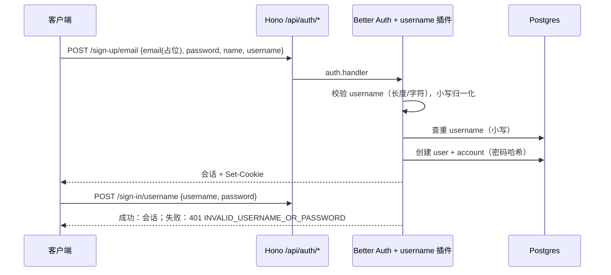

# 用户名认证（服务端） - 技术设计

## 概述
在 `packages/auth` 的 `createAuth` 中注册 Better Auth `username` 插件，并用 `disabledPaths` 关闭邮箱登录接口。用户名规则抽成不依赖服务端的共享模块，供 web / native 前端复用。通过 `auth:generate` 和迁移为 `user` 表增加 `username` / `displayUsername`。为后端搭建 Vitest 并覆盖所有验收标准。

## 涉及端
后端（`packages/auth`、`packages/db`、`packages/api`、`apps/server`）。

## 架构 / 流程



## 共享模块：`packages/auth/src/username.ts`
纯函数与常量，不 import `better-auth` 服务端代码，前端可通过 `@ai-admin/auth/username` 子路径导入。

```ts
export const USERNAME_MIN_LENGTH = 3;
export const USERNAME_MAX_LENGTH = 20;
export const USERNAME_PATTERN = /^[a-zA-Z0-9_]+$/;
export const PASSWORD_MIN_LENGTH = 8;
export const PLACEHOLDER_EMAIL_DOMAIN = "users.ai-admin.local";

export const isValidUsername = (username: string): boolean => USERNAME_PATTERN.test(username);
export const toPlaceholderEmail = (username: string): string =>
  `${username.toLowerCase()}@${PLACEHOLDER_EMAIL_DOMAIN}`;
```

## `createAuth` 改动（`packages/auth/src/index.ts`）

```ts
emailAndPassword: { enabled: true, minPasswordLength: PASSWORD_MIN_LENGTH },
disabledPaths: ["/sign-in/email"],
plugins: [
  expo(),
  username({
    minUsernameLength: USERNAME_MIN_LENGTH,
    maxUsernameLength: USERNAME_MAX_LENGTH,
    usernameValidator: isValidUsername,
  }),
],
```
插件默认行为（已核对 better-auth 1.7.12 源码）：
- `usernameNormalization` 默认转小写，查重与登录都按小写，满足“不区分大小写”。
- `displayUsername` 保存原始大小写。
- 默认 validator 允许 `.`，因此必须传自定义 `usernameValidator`。
- 错误码：`USERNAME_IS_ALREADY_TAKEN`（400）、`INVALID_USERNAME_OR_PASSWORD`（401）、`USERNAME_TOO_SHORT` / `USERNAME_TOO_LONG` / `INVALID_USERNAME`（422）。

## 数据模型
`pnpm auth:generate` 重新生成 `packages/db/prisma/schema/auth.prisma`，`User` 新增：

| 字段 | 类型 | 说明 |
| --- | --- | --- |
| `username` | `String? @unique` | 小写归一化后的用户名 |
| `displayUsername` | `String?` | 原始大小写 |

然后 `pnpm db:generate`、`pnpm db:migrate`（迁移名 `add_username`）。

## 接口设计

| 接口 | 说明 |
| --- | --- |
| `POST /api/auth/sign-up/email` | body：`email`（占位）、`password`、`name`、`username`。重复返回 400 `USERNAME_IS_ALREADY_TAKEN` |
| `POST /api/auth/sign-in/username` | body：`username`、`password`。失败统一 401 `INVALID_USERNAME_OR_PASSWORD` |
| `POST /api/auth/sign-in/email` | 关闭，返回 404 |
| `POST /api/auth/sign-out` | 不变 |
| tRPC `privateData`（`protectedProcedure`） | 不变；未登录 `UNAUTHORIZED` |

## 可测试性改造（假设）
`apps/server/src/index.ts` 在 import 时直接 `serve()`，无法在测试中使用 `app.request()`。拆分：
- `apps/server/src/app.ts`：`createApp(auth)` 组装 Hono 应用（CORS、`/api/auth/*`、`/trpc/*`、`/`）并返回。
- `apps/server/src/index.ts`：用 `services.ts` 的单例调用 `createApp` 后 `serve()`。

## 异常处理
- 前端生成的占位邮箱若已存在（理论上只在同名用户下发生），Better Auth 会先因 username 查重返回 `USERNAME_IS_ALREADY_TAKEN`；前端仍需把 `USER_ALREADY_EXISTS*` 也映射为「该用户名已被注册」（见 02/03）。
- 登录时用户名长度/字符不合法：插件返回 422 而不是 401，前端统一映射为「用户名或密码错误」（见 02/03）。

## 测试策略
Vitest（`apps/server`），连接 `DATABASE_URL` 指向的库，每个用例用随机用户名，测试结束删除创建的用户。
- 注册成功：返回 user，`username` 为小写、`displayUsername` 保留大小写，响应不含 `password`。
- 大小写不同重复注册：`USERNAME_IS_ALREADY_TAKEN`。
- 非法用户名（太短、太长、含 `.` / `-`）：被拒绝。
- 密码 7 位：被拒绝。
- 正确登录（大写用户名也可）：200 且有 `set-cookie`。
- 错误密码、不存在用户：都是 401 `INVALID_USERNAME_OR_PASSWORD`。
- `POST /api/auth/sign-in/email`：404。
- `appRouter.createCaller({ session: null, ... }).privateData()`：`UNAUTHORIZED`；带登录 cookie 调 `/trpc/privateData`：返回的 user 含 `username`。
