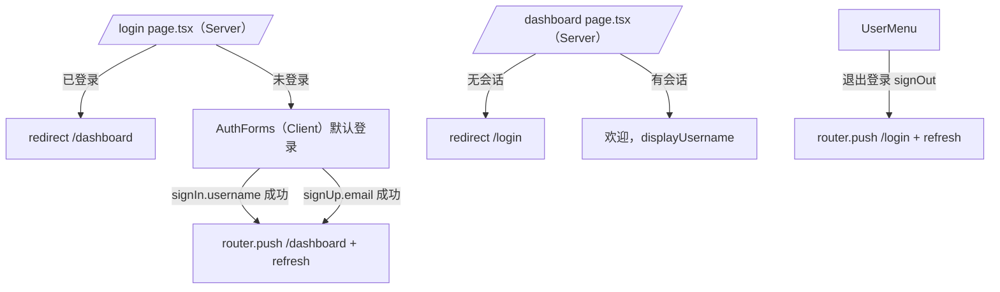

# Web 登录注册与访问控制 - 技术设计

## 概述
web 端 `authClient` 注册 `usernameClient()`；改写现有 `sign-in-form` / `sign-up-form` 为用户名表单，校验规则复用 `@ai-admin/auth/username`；`/login` 改为 Server Component 校验会话后渲染客户端表单切换组件；Dashboard 与用户菜单显示用户名；退出跳转 `/login`。用 Playwright 覆盖需求 §8 的 6 条验收标准。

## 涉及端
网页（`apps/web`）。

## 架构 / 流程



## 文件改动

| 文件 | 改动 |
| --- | --- |
| `apps/web/package.json` | 增加依赖 `@ai-admin/auth: workspace:*`（只导入 `@ai-admin/auth/username` 子路径） |
| `apps/web/src/lib/auth-client.ts` | `plugins: [usernameClient()]`（`better-auth/client/plugins`） |
| `apps/web/src/lib/auth-errors.ts`（新） | `getSignUpErrorMessage(code)` / `getSignInErrorMessage()`：错误码映射为中文 |
| `apps/web/src/components/sign-up-form.tsx` | 字段：用户名、密码；`signUp.email({ email: toPlaceholderEmail(u), name: u, username: u, password })` |
| `apps/web/src/components/sign-in-form.tsx` | 字段：用户名、密码；`signIn.username({ username, password })` |
| `apps/web/src/app/login/page.tsx` | Server Component：有会话 `redirect("/dashboard")`，否则渲染 `<AuthForms />` |
| `apps/web/src/app/login/auth-forms.tsx`（新） | Client：`useState` 切换，默认登录 |
| `apps/web/src/app/dashboard/page.tsx` | 显示「欢迎，{displayUsername ?? username}」 |
| `apps/web/src/components/user-menu.tsx` | 显示用户名；去掉邮箱项；「退出登录」后 `router.push("/login")` + `router.refresh()` |

## 表单校验（Zod）

```ts
// 注册
z.object({
  username: z.string()
    .min(USERNAME_MIN_LENGTH, "用户名至少 3 个字符")
    .max(USERNAME_MAX_LENGTH, "用户名最多 20 个字符")
    .regex(USERNAME_PATTERN, "用户名只能包含字母、数字和下划线"),
  password: z.string().min(PASSWORD_MIN_LENGTH, "密码至少 8 个字符"),
})
// 登录
z.object({
  username: z.string().min(1, "请输入用户名"),
  password: z.string().min(1, "请输入密码"),
})
```

## 错误映射

| 场景 | 错误码 | 文案 |
| --- | --- | --- |
| 注册重复 | `USERNAME_IS_ALREADY_TAKEN`、`USER_ALREADY_EXISTS`、`USER_ALREADY_EXISTS_USE_ANOTHER_EMAIL` | 该用户名已被注册 |
| 注册其他失败 | 其他 | 注册失败，请稍后重试 |
| 登录失败 | 任意 4xx（含 422 用户名格式不合法） | 用户名或密码错误 |
| 网络 / 5xx | — | 网络异常，请稍后重试 |

## 前端 / 交互
- 文案：标题「登录」/「注册」，按钮「登录」/「注册」，提交中「提交中...」，切换链接「还没有账号？去注册」/「已有账号？去登录」。
- 成功 toast：「登录成功」/「注册成功」/「已退出登录」。
- 用 `<form onSubmit>` 实现回车提交；`<Label htmlFor>` 关联输入框；密码框 `type="password"`、`autoComplete` 合理设置。
- 成功跳转后调用 `router.refresh()`，保证 Server Component 读取到新 cookie。

## 异常处理
- `getSession` 失败（服务端不可用）时，`/dashboard` 按未登录处理重定向 `/login`（现有 `throw: true` 会抛 500，改为不抛并判空）。

## 测试策略
Playwright（`apps/web/e2e`），`webServer` 同时启动 server（:3000）和 web（:3001），每个用例用随机用户名：
1. 注册新用户名 → 进入 `/dashboard`，看到「欢迎，{用户名}」。
2. 用仅大小写不同的用户名再注册 → toast「该用户名已被注册」。
3. 错误密码登录 → toast「用户名或密码错误」。
4. 未登录访问 `/dashboard` → URL 为 `/login`。
5. 退出登录后访问 `/dashboard` → `/login`。
6. 登录后刷新 `/dashboard` → 仍显示欢迎语。
7. 已登录访问 `/login` → `/dashboard`。
8. 注册表单非法输入 → 显示字段错误，不发请求。

> 注意：cookie 为 `secure; sameSite=none`，`localhost` 下浏览器允许 secure cookie，E2E 使用 `http://localhost` 即可（若不生效，在 AGENTS.md 记录处理方式）。
